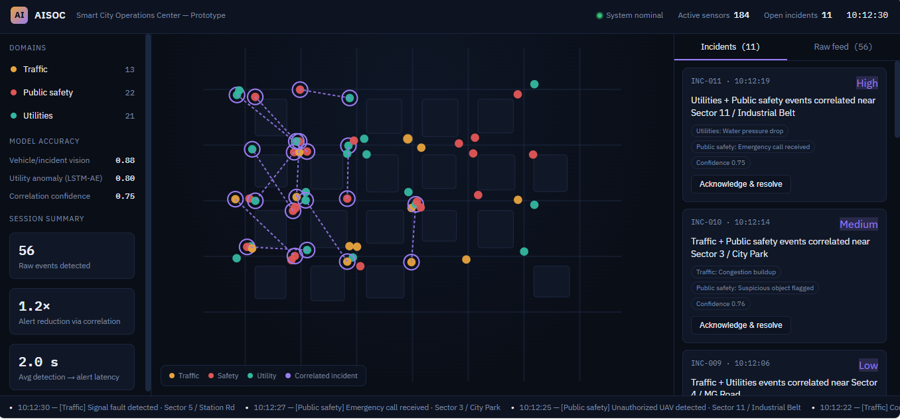

# AI Smart City Operations Center (AISOC)

**An AI-assisted Smart City Operations Center Dashboard Prototype**

AISOC is a browser-based dashboard prototype that demonstrates how traffic, public safety, and utility events can be monitored through a unified Smart City Operations Center interface.

The prototype simulates event monitoring, cross-domain event correlation, and incident management through an interactive dashboard.

> **Prototype Notice:** This is a front-end simulation, not a production AI system. Events, sensor counts, confidence values, and map locations are generated or represented in JavaScript. No live sensor integration, trained machine-learning model, backend API, database, authentication, or real emergency dispatch is currently implemented.

## Live Demo

[**Open AISOC Dashboard**](https://arunatamilarasu58-cpu.github.io/AI-Smart-City-Operations-Center/)

## Features

- Dark-themed operations dashboard
- Traffic, public safety, and utility event monitoring
- Simulated real-time event feed with timestamps and severity levels
- Generated city-grid visualization with event markers
- Rule-based cross-domain event correlation
- Incident management with acknowledge and resolve actions
- Interactive domain filters
- KPI counters and activity ticker

## Technologies Used

- HTML5
- CSS3
- JavaScript
- SVG for city-map visualization
- Git and GitHub
- GitHub Pages for deployment

## Run Locally

No build tools or installation are required.

1. Clone the repository:

   ```bash
   git clone https://github.com/arunatamilarasu58-cpu/AI-Smart-City-Operations-Center.git
   ```

2. Open the project folder.
3. Open `index.html` in a modern web browser.

Alternatively, start a local server:

```bash
python -m http.server 8000
```

Open `http://localhost:8000` in your browser.

## Project Structure

```text
AI-Smart-City-Operations-Center/
├── index.html
├── README.md
├── .gitignore
├── LICENSE
├── docs/
│   └── PROJECT_OVERVIEW.md
└── screenshots/
```

## Screenshots

### Dashboard



## Current Limitations

- Events are randomly generated using JavaScript.
- The city map is a schematic visualization, not a real geographic map.
- Displayed model-accuracy values are illustrative and not measured evaluation results.
- Event correlation uses basic time and distance rules, not a trained AI model.
- Data is not persisted after refreshing the browser.
- Google Fonts requires an internet connection to load the selected fonts.

## Future Enhancements

- Integrate real or simulated sensor APIs through a backend.
- Store events and incidents in a database.
- Implement operator authentication and role-based access.
- Integrate a geographic map.
- Train and evaluate machine-learning models using real datasets.
- Add automated tests and responsive layouts.

## License

See the [LICENSE](LICENSE) file for license information.

## Author

**Arun Tamilarasu**

GitHub: [@arunatamilarasu58-cpu](https://github.com/arunatamilarasu58-cpu)